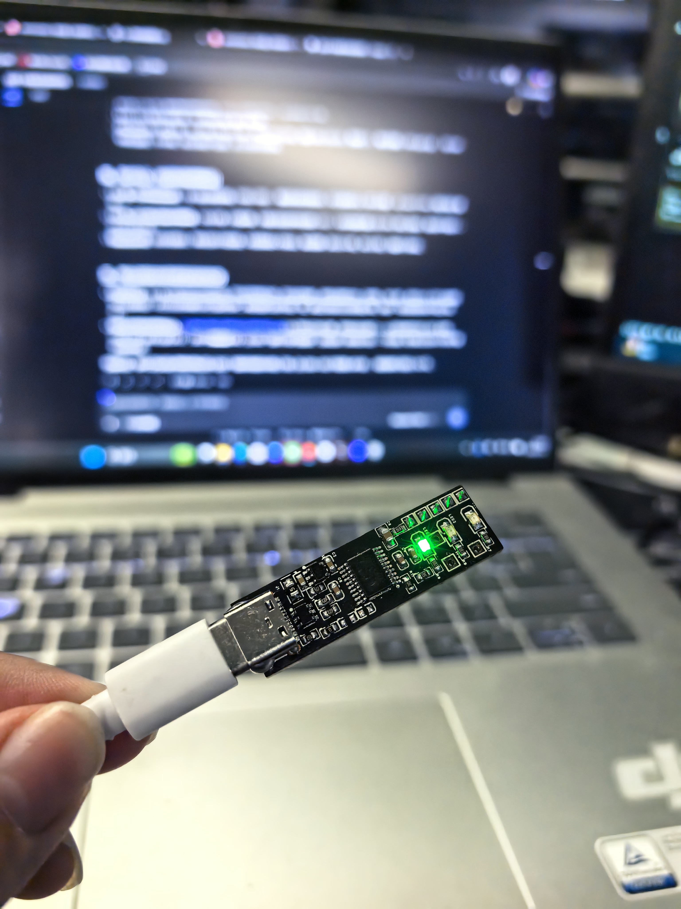
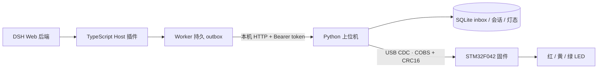

# Agent Light · Agent 三色状态指示灯

[](LICENSE)



Agent Light 是一套本地运行的 USB 状态灯系统，用红、黄、绿三颗 LED 显示 AI 编程助手的运行、等待、失败和完成状态。

项目包含 Rev A 硬件、STM32 固件、Python 上位机和 DeepSeek Harness（DSH）插件。插件采集生命周期事件，上位机汇总多个聊天的状态，再通过 USB CDC 控制灯板。

**当前可用链路：DSH Web → 插件 → Python 上位机 → USB 灯板。** 2026-11-06 已完成真实对话的“运行黄灯、完成绿灯”联调。Codex 目前仅预留统一事件接口，尚未实现真实适配器。

桌面预览版下载见 [GitHub Release](https://github.com/SimpleAstronaut/Agent-Light/releases/tag/v0.2.1-preview.1)，安装见 [安装手册](docs/installation-guide.md)。桌面版使用与源码运行见 [桌面指南](docs/desktop-guide.md)，实施与验证状态见 [进度记录](docs/superpowers/plans/2026-11-08-desktop-ui-progress.md)。

## 阅读导航

- [项目状态与架构](#项目状态与架构)
- [灯态说明](#灯态说明)
- [目录结构](#目录结构)
- [首次安装与启动](#首次安装与启动)
- [将插件接入 dsh-web 启动入口](#7-将插件接入-dsh-web-启动入口一次配置)
- [日常使用手册](#日常使用手册)
- [配置说明](#配置说明)
- [故障排查](#故障排查)
- [硬件与固件](#硬件与固件)
- [开发与验证](#开发与验证)
- [接口与文档索引](#接口与文档索引)

## 项目状态与架构

| 模块 | 当前内容 | 版本或基线 |
|---|---|---|
| 硬件 | 原理图、PCB、BOM、坐标和 Gerber 初稿；用户已焊接实板 | Rev A，STM32F042F6P6 |
| 固件 | FreeRTOS 静态任务、USB CDC、协议解析、PWM 灯效、链路看门狗 | 1.0.0 / USB 协议 v1 |
| 上位机 | 本地 HTTP、SQLite 状态持久化、聚合、串口管理、CLI | Python 包 0.2.1 |
| DSH 插件 | 顶层会话、回合、审批与提问观察，Worker 持久队列和补报 | 0.1.3 |
| Codex | 通用 schema、来源隔离和聚合接口已预留 | 真实适配器未实现 |
| 桌面界面 | PySide6 桌面、Agent 二级导航、托盘、设备管理、DSH 确认式接入、安装器 | 0.2.1，实板与登录验收见实施记录 |



插件不打开 COM 口；只有上位机串口 worker 操作设备。上位机不解析聊天内容，固件不理解 Agent 会话。多个顶层聊天共同参与聚合，子 Agent 不独立形成灯态。

已有验证包括固件构建、主机协议测试、实板 HIL、软件链路检查，以及一次真实 DSH 对话控灯。完整审批/提问/PTC 路径、并发性能、断电故障注入、24 小时长稳、USB 挂起电流和 ESD 等仍需进一步验证。能力文件中的 `unverified` 保留完整验收边界，不代表基础链路不可用。

## 灯态说明

LED 从上到下为红、黄、绿。

| 灯效 | 状态 | 含义 |
|---|---|---|
| 全灭 | `IDLE` | 空闲、没有活动任务或完成保持已到期 |
| 黄灯常亮 | `RUNNING` | 正在运行 |
| 红灯常亮 | `ATTENTION` | 等待审批或回答问题 |
| 红灯 2 Hz 闪烁 | `ERROR` | 任务明确失败，或采集源故障/失联；用 `status` 区分 |
| 绿灯常亮 | `COMPLETED` | 观测到回合完成，默认保持 300 秒 |
| 黄灯 1 Hz 慢闪 | `WAIT_SYNC` / `LINK_LOST` | 灯板等待同步，或与上位机通信中断 |
| 上电红 → 黄 → 绿各短亮 | 启动自检 | 随后等待上位机同步 |

跨会话优先级：`ERROR > ATTENTION > RUNNING > COMPLETED > IDLE`。一个聊天完成不会盖住另一个仍在运行或等待的聊天。用户取消不显示完成绿灯；仍未解决的问题可以继续保持红灯等待。绿灯只表示回合结束，不表示代码正确或任务验收通过。

## 目录结构

下面列出主要源码和交付目录；依赖、构建缓存及历史文件有所省略。

```text
agent-light/
├─ README.md                         # 项目入口与使用手册
├─ contracts/                        # 各层共用的协议和能力边界
│  ├─ usb-protocol-v1.md              # USB 帧、命令、ACK、revision
│  ├─ usb-vectors.json               # USB 黄金向量
│  ├─ event-schema.json              # HTTP 统一事件 schema
│  ├─ fsm-transitions.md             # 状态、等待集合、来源交接规则
│  ├─ source-contract.schema.json    # 来源能力声明格式
│  ├─ toolchain.lock.json            # 固件工具链基线
│  └─ dsh/0.2.1-rc.2/                # DSH 指纹与能力记录
├─ hardware/eda/                     # 嘉立创 EDA 专业版工程
│  ├─ Agent-Light-v1.epro2            # 原理图工程包
│  ├─ Agent-Light-v1-layout.epro2     # 含 PCB 的工程包
│  ├─ BOM-RevA.csv                   # BOM
│  ├─ Agent-Light-RevA-DRAFT-Gerber.zip
│  ├─ sources/                       # 原生文本源码备份
│  └─ previews/                      # 原理图与 PCB 预览
├─ firmware/
│  ├─ Core/                          # 系统入口与 HAL/FreeRTOS 配置
│  ├─ app/                           # 协议、COBS、CRC、显示与板级代码
│  ├─ USB_Device/                    # USB CDC 集成与控制请求防护
│  ├─ cubemx/                        # 外设 IOC 参考配置
│  ├─ MDK-ARM/                       # Keil 工程
│  ├─ vendor/                        # 锁定的第三方依赖
│  ├─ tests/host/                    # 固件主机测试
│  ├─ tools/                         # 黄金向量、产物检查与实板 HIL
│  ├─ docs/                          # 构建、接口、bring-up 与验证记录
│  ├─ build/                         # 固件产物、日志、实板报告
│  ├─ fetch-dependencies.ps1
│  └─ build.ps1
├─ pc/
│  ├─ agent_light/
│  │  ├─ api.py                      # 本地 HTTP 入口
│  │  ├─ core.py                     # SQLite、状态机、聚合与来源健康
│  │  ├─ serial_link.py              # 串口发现、事务、重连与设备同步
│  │  ├─ protocol.py                 # USB 编解码
│  │  ├─ config.py                   # 用户配置与 token 初始化
│  │  ├─ locking.py                  # 服务进程锁
│  │  ├─ cli.py                      # agent-light 命令
│  │  └─ event-schema.json           # 随 Python 包分发的 schema
│  ├─ tests/
│  ├─ pyproject.toml
│  └─ .venv/                         # 本机 Python 虚拟环境
├─ plugins/dsh/
│  ├─ src/
│  │  ├─ index.ts                    # Host 插件、启动门禁与释放
│  │  ├─ adapter-0.2.1-rc.2.ts        # 锁定版本事件映射
│  │  ├─ reporter.ts                 # 有界入队与活动节流
│  │  ├─ worker.ts                   # 持久队列、HTTP 和重放
│  │  ├─ host-lock.ts                # 宿主文件指纹
│  │  └─ types.ts
│  ├─ dist/                          # 编译后的 JS，实际运行入口
│  ├─ tests/
│  ├─ tools/                         # 宿主、启动竞态、集成检查
│  ├─ cordis.patch.yml               # bundle 默认禁用节点
│  ├─ package.json
│  └─ package-lock.json
├─ docs/superpowers/                 # 专项设计与实施计划
├─ outputs/
│  ├─ agent-indicator-design.md      # 早期总体设计
│  ├─ agent-indicator-execution-plan.md
│  ├─ agent-light.local.patch.yml    # 本机生成的 DSH overlay
│  ├─ packages/                      # wheel 与 npm tgz 构建产物
│  ├─ *implementation.md / *fix.md    # 实施、联调与修复记录
│  └─ dev-runtime/                   # 本机临时联调文件，不作为发布配置
└─ .tmp/                             # 调研资料与临时文件
```

## 首次安装与启动

以下以 Windows PowerShell、项目位置 `D:\projects\agent-light` 为例。项目路径变化时，应重新生成 overlay。已有虚拟环境和构建产物可跳过安装步骤。

首次获取源码可执行：

```powershell
git clone https://github.com/SimpleAstronaut/Agent-Light.git
cd Agent-Light
```

后续示例中的 `D:\projects\agent-light`、`D:\deepseek` 等是开发机路径，需替换为自己的项目与 DSH 安装位置。源码仓库不包含本机用户配置、outbox、虚拟环境、`node_modules`、`dist`、固件构建缓存和 Python/npm 安装包；克隆后按下面步骤构建并生成自己的 overlay。README 中记录的构建包与实板报告是本机历史产物，不保证随 Git 源码附带。

### 1. 准备环境

| 项目 | 要求或已核查版本 |
|---|---|
| Python | 声明要求 3.11+；本机使用 3.14 |
| Node.js | 本机 DSH 使用 22.23.2；不要随意替换其启动运行时 |
| DSH | 0.2.1-rc.2，入口 `dsh.cmd` |
| Cordis | 4.0.5，由 DSH 提供 |
| TypeScript | 构建依赖锁定 5.7.3，由 npm 安装 |
| 灯板 | 已烧录当前固件，使用可传输数据的 USB 线连接 |

插件会检查宿主版本和文件指纹。升级 DSH 后需要核查适配，不能靠修改版本号或关闭门禁认定兼容。

### 2. 安装上位机与构建插件

```powershell
cd D:\projects\agent-light

py -3.14 -m venv pc/.venv
pc/.venv/Scripts/python.exe -m pip install -e ./pc

Push-Location plugins/dsh
npm.cmd ci --legacy-peer-deps --ignore-scripts --no-audit --no-fund
npm.cmd run build
Pop-Location
```

从源码运行推荐使用上述 editable 安装。预构建文件也保存在 `outputs/packages/`，桌面版为 `AgentLight-0.2.1-windows-x64-setup.exe` 或同名便携 zip，Python 包为 `agent_light-0.2.1-py3-none-any.whl`。DSH 插件运行版本仍为 0.1.3，带桌面检测工具的归档为 `agent-light-dsh-0.1.3-desktop.tgz`；旧版本保留作历史产物。

### 3. 初始化配置

在普通 PowerShell 中执行，避免经由会重写用户目录的 `dsh.cmd` 初始化：

```powershell
pc/.venv/Scripts/agent-light.exe init
```

命令输出配置文件绝对路径，Windows 默认是 `%LOCALAPPDATA%\AgentLight\config.json`。首次初始化会生成随机 token 并收紧目录权限；已有配置不会被覆盖。

### 4. 启动上位机

连接灯板后执行，并保持这个终端运行：

```powershell
pc/.venv/Scripts/agent-light.exe serve
```

上位机默认监听 `http://127.0.0.1:17321`。在第二个终端检查：

```powershell
cd D:\projects\agent-light
pc/.venv/Scripts/agent-light.exe health
pc/.venv/Scripts/agent-light.exe status
pc/.venv/Scripts/agent-light.exe test
```

`status.device.confirmed: true` 表示本次连接的 SET ACK 与新鲜 STATUS 一致；`connected` 保留为通信标志。`test` 在设备就绪后依次红、黄、绿，每色 ACK 后保持至少一秒，再以 ACK 恢复最新聚合灯态。

自动发现按配置的 VID/PID 和可选序列号匹配；找不到或匹配多块板时，按“配置说明”指定实际 COM 口。`COM6` 是一次实板报告使用的端口，不保证下次仍相同。

### 5. 生成 DSH overlay

```powershell
pc/.venv/Scripts/agent-light.exe overlay |
    Set-Content -Encoding utf8 outputs/agent-light.local.patch.yml
```

生成的配置包含 endpoint、tokenFile/dataDir 的绝对路径，不含 token 内容。插件入口应为构建文件的 URL：

```yaml
name: "file:///D:/projects/agent-light/plugins/dsh/dist/index.js"
```

不要把入口改成插件目录；ESM 加载器会报 `ERR_UNSUPPORTED_DIR_IMPORT`。非默认插件目录可用 `overlay --package <插件目录>` 指定。

### 6. 启动 DSH Web

**开发机便捷入口已配置：上位机运行后，直接执行 `dsh-web` 即可自动加载 Agent Light，并按原逻辑打开浏览器。** `D:\deepseek\bin\dsh-web.ps1` 会自动带入本项目 overlay；`dsh-web --no-open` 可不打开浏览器。克隆源码不会修改新电脑的启动脚本；请按第 7 节配置自己的入口，或使用下面的完整命令。

先退出已有的 DSH Web 后端。**关闭网页不等于退出后端**；之前由调试脚本启动的隐藏后台进程也会占用 3080 和 outbox 锁。可先检查：

```powershell
Get-NetTCPConnection -State Listen -LocalPort 3080 -ErrorAction SilentlyContinue |
    Select-Object LocalAddress, LocalPort, OwningProcess
```

若有监听者，先在原终端按 `Ctrl+C` 退出。找不到原终端时，按“日常使用手册”核对具体 DSH PID，确认没有正在执行的任务后停止该实例。不要在旧后端仍运行时启动第二个共享同一 profile/outbox 的实例。

确认端口空闲后执行：

```powershell
# 本机已配置的快捷方式
dsh-web

# 或使用通用的显式启动方式（二选一，不要同时运行）
dsh.cmd --profile web --patch D:/projects/agent-light/outputs/agent-light.local.patch.yml --no-open
```

保持此终端运行，打开 DSH 打印的本机 Web 地址；`--no-open` 表示不自动打开浏览器。该地址可能包含登录 token，不要公开粘贴。

启动后插件应出现 `[agent-light]` 的 `CAPTURE_READY` 诊断，PC `status` 中应出现 DSH 来源。来源完成 `runtime_ready` 和健康登记后为 `healthy`。发送一句测试对话，应看到运行黄灯、正常完成绿灯。

### 7. 将插件接入 dsh-web 启动入口（一次配置）

目标：上位机已启动时，直接输入 `dsh-web` 就加载插件，无需每次手工输入 `--patch`。**当前电脑已完成本节配置，不必重复修改；以下用于重装、迁移或其他电脑安装。**

该方式是在 `dsh-web` 启动脚本中自动追加 overlay 参数，不是将插件直接安装进上位机，也不需要修改 DSH 原始包或 `web` profile。上位机仍需单独运行。

#### 7.1 准备插件和 overlay

先完成前面的上位机安装、`init` 和插件 `npm.cmd run build`，然后在普通 PowerShell 中生成配置：

```powershell
cd D:\projects\agent-light
pc/.venv/Scripts/agent-light.exe overlay |
    Set-Content -Encoding utf8 outputs/agent-light.local.patch.yml
```

如果使用自定义 PC 配置，生成时也应带同一个 `--config`。确认 overlay 中的模块入口指向 `dist/index.js`，endpoint、tokenFile 和 dataDir 与上位机一致。

#### 7.2 找到并备份启动脚本

```powershell
Get-Command dsh-web | Select-Object Name, CommandType, Source
```

本机结果是 `D:\deepseek\bin\dsh-web.ps1`。以下修改针对这种 PowerShell 包装脚本；如果你的入口是其他类型，应修改它实际调用的启动文件，不能直接套用 PowerShell 代码。

新环境中，修改前备份：

```powershell
$launcherPath = (Get-Command dsh-web).Source
$launcherBackupPath = "$launcherPath.agent-light.before.bak"
if (-not (Test-Path -LiteralPath $launcherBackupPath)) {
    Copy-Item -LiteralPath $launcherPath -Destination $launcherBackupPath
}
notepad.exe $launcherPath
```

本机第一次接入前的原始备份另保存在 `D:\deepseek\backups\dsh-web-before-agent-light-20261106.ps1`。

#### 7.3 加入默认插件参数

在脚本中找到：

```powershell
$dshWebArguments = @($args)
```

在这一行之后、计算 `$dshShouldOpen` 和调用 `dsh.cmd` 之前，插入下面代码。将 `$agentLightPatchPath` 改为本机 overlay 的真实绝对路径。若脚本已包含这段接入逻辑，只需核对路径，不要重复插入。

```powershell
$agentLightPatchPath = 'D:/projects/agent-light/outputs/agent-light.local.patch.yml'
$agentLightAlreadyIncluded = $false
for ($argumentIndex = 0; $argumentIndex -lt $dshWebArguments.Count; $argumentIndex++) {
    $argument = [string]$dshWebArguments[$argumentIndex]
    $candidatePatch = $null
    if ($argument -eq '--patch' -and $argumentIndex + 1 -lt $dshWebArguments.Count) {
        $candidatePatch = [string]$dshWebArguments[$argumentIndex + 1]
    } elseif ($argument.StartsWith('--patch=')) {
        $candidatePatch = $argument.Substring(8)
    }
    if ($candidatePatch) {
        try {
            if ([IO.Path]::GetFullPath($candidatePatch) -eq [IO.Path]::GetFullPath($agentLightPatchPath)) {
                $agentLightAlreadyIncluded = $true
            }
        } catch {}
    }
}
if (-not $agentLightAlreadyIncluded) {
    if (Test-Path -LiteralPath $agentLightPatchPath -PathType Leaf) {
        $dshWebArguments = @('--patch', $agentLightPatchPath) + $dshWebArguments
    } else {
        Write-Warning 'Agent Light overlay was not found; starting DSH without the status-light plugin.'
    }
}
```

保存后保留脚本原有的浏览器打开逻辑和参数转发。此代码会自动带入 overlay；用户已显式传入同一 overlay 时不会重复添加，overlay 文件丢失时会提示并继续启动 DSH。

#### 7.4 启动并确认

先停止旧 DSH 后端，确认 3080 未被旧实例占用；保持上位机终端运行，再在另一个终端执行：

```powershell
dsh-web
```

需要只启动后端、不打开浏览器时使用 `dsh-web --no-open`。出现 `CAPTURE_READY` 后检查：

```powershell
cd D:\projects\agent-light
pc/.venv/Scripts/agent-light.exe status
```

确认来源为 `healthy`、`lease_expired: false`，设备 `connected: true`。实际发送一句对话，核对运行黄灯、完成绿灯。此后每次只需先启动上位机，再执行 `dsh-web`；不用重复安装或生成 overlay。

#### 7.5 停用、恢复与迁移

- 临时不加载插件：停止 DSH 后使用 `dsh.cmd --profile web --no-open`，绕过包装脚本。
- 永久取消默认接入：从 `dsh-web.ps1` 删除刚加入的 Agent Light 参数块；若确认脚本后来没有其他需要保留的修改，也可恢复修改前备份。
- 新环境中使用本节备份恢复时，可执行下面命令；若重开了终端，先重新设置两个变量为真实路径：

```powershell
Copy-Item -LiteralPath $launcherBackupPath -Destination $launcherPath -Force
```

- 项目移动、用户配置路径变化后，重新生成 overlay，并更新启动脚本中的 `$agentLightPatchPath`。
- DSH 安装或升级如果覆盖了包装脚本，需要重新核对接入代码；DSH 版本变化还需单独核查插件适配。

## 日常使用手册

### 启动、停止和更新

日常只需要两个长期运行的终端：一个执行 `agent-light.exe serve`，一个执行 `dsh-web`（本机已自动带入 overlay），或通用的显式 DSH 启动命令。首次配置完成后，不必每次运行 `init`、npm 安装或生成 overlay。

- **停止 DSH**：在启动它的终端按 `Ctrl+C`。采集源停止后，上位机仍运行时可能因来源失联显示红闪。
- **停止上位机**：在服务终端按 `Ctrl+C`。灯板约五秒后可能进入链路丢失黄闪；断开 USB 后熄灭。
- **更新插件源码**：重新执行 `npm.cmd run build`，再重启 DSH。修改 dist/overlay 不代表运行中的旧进程已加载新代码。
- **修改 PC 配置**：重启上位机；若改变 endpoint、tokenFile、dataDir 或项目路径，还需重新生成 overlay 并重启 DSH。
- **停用插件**：停止 DSH，使用 `dsh.cmd --profile web --no-open` 绕过已集成插件的 `dsh-web` 包装脚本。
- **移除接入**：先停止相关服务，备份所需配置和 outbox，再按需移除文件。未确认的 outbox 不应直接删除。

调试期间可能使用了隐藏后台 DSH；关闭浏览器不会停止后端。若前台重新启动提示端口占用，可先只查本项目的 DSH PID：

```powershell
Get-CimInstance Win32_Process |
    Where-Object {
        $_.Name -eq 'node.exe' -and
        $_.CommandLine -like '*dsh*bin.js*agent-light.local.patch.yml*'
    } |
    Select-Object ProcessId, CommandLine
```

确认没有正在执行的任务、且目标确为本项目测试后端，再按查到的 PID 停止它；不要批量结束全部 Node/Python 进程。

本机 `dsh-web` 入口位于 `D:\deepseek\bin\dsh-web.ps1`，overlay 路径配置为 `D:/projects/agent-light/outputs/agent-light.local.patch.yml`。显式传入相同 overlay 时不会重复添加。若项目移动，需重新生成 overlay 并更新该脚本路径。原脚本备份位于 `D:\deepseek\backups\dsh-web-before-agent-light-20261106.ps1`；恢复该备份可取消入口的自动接入。

### CLI 命令速查

以下命令均在项目根目录执行，完整前缀为 `pc/.venv/Scripts/agent-light.exe`。

| 子命令 | 用途 |
|---|---|
| `init` | 创建用户配置和 token；已有配置保持不变 |
| `serve` | 启动本地服务与串口 worker |
| `health` | 查看服务、协议及来源声明；不代表灯板已连接 |
| `status` | 查看来源健康、会话、聚合状态和设备确认 |
| `test` | ACK 驱动的红黄绿测试，不改写 Agent 会话；未就绪退出 3 |
| `clear` | 清除会话的 ERROR/COMPLETED 基础状态 |
| `overlay` | 生成直接引用本地构建文件的 DSH overlay |
| `overlay --installed` | 生成覆盖已安装 bundle 节点的 overlay |
| `event` | 从 stdin 上报统一事件，供适配器开发使用 |

`clear` 不会解除仍在等待的问题，也不能修复来源失联、鉴权或磁盘故障；这些情况需要处理故障本身。`event` 是通用事件入口，不是现成的 Codex Hook。

使用独立配置时，所有相关命令都要带同一个路径：

```powershell
pc/.venv/Scripts/agent-light.exe --config D:/my-agent-light/config.json init
pc/.venv/Scripts/agent-light.exe --config D:/my-agent-light/config.json serve
```

### 如何阅读 status

| 字段 | 判断方法 |
|---|---|
| `desired` | 当前所有来源/会话聚合后的业务灯态 |
| `connected`、`serial_diagnostic` | 串口 worker 是否已确认设备通信 |
| `revision`、`acked_revision` | 期望与设备确认的代次；稳定后应对齐 |
| `sources.*.health` | `recovering` 为启动交接未完成，`healthy` 为健康，`degraded` 为采集故障 |
| `sources.*.lease_expired` | 超过 15 秒未收到来源心跳时为 true |
| `sources.*.persisted_seq`、`acked_seq` | 插件落盘与终局确认水位；积压时可能不同 |
| `sessions.*.base`、`waits` | 会话基础状态与独立等待集合；`retired` 实例不再贡献灯态 |

## 配置说明

Windows 默认运行数据：

```text
%LOCALAPPDATA%/AgentLight/
├─ config.json                # PC 配置
├─ token                      # Bearer 凭据，不公开
├─ state.sqlite3              # inbox、来源、会话、灯态
├─ state.sqlite3-wal / -shm   # SQLite 运行时文件，可能出现
├─ state.sqlite3.lock          # 服务锁文件
└─ dsh-outbox/
   ├─ checkpoint.json         # 身份、计数器与确认水位
   ├─ checkpoint.json.previous
   ├─ segment-*.jsonl         # 持久事件队列，按需出现
   ├─ owner.lock              # outbox 单写入者锁，运行时出现
   ├─ diagnostics.json        # 最近一次 code / phase / time
   └─ quarantine.json         # 协议拒绝时保留的隔离记录，按需出现
```

checkpoint 含身份密钥；token 与数据库/outbox 均应保留在用户私有目录。备份数据库时先停止上位机；移动 outbox 时先停止 DSH，完整保留 checkpoint 与未确认 segment。

### 上位机 config.json

| 字段 | 默认值 | 说明 |
|---|---|---|
| `endpoint` | `http://127.0.0.1:17321` | 服务监听地址，只允许 IPv4 loopback HTTP |
| `tokenFile` | 初始化生成的绝对路径 | PC 与插件共用的 token 文件 |
| `dataDir` | 用户目录下 `dsh-outbox` | 插件持久队列目录，由 overlay 传入 |
| `database` | 用户目录下 `state.sqlite3` | PC 数据库 |
| `brightness` | `35` | 20–100 的整数，IDLE 始终全灭 |
| `completedHoldSeconds` | `300` | 首次有效接收完成事件后的保持秒数；0 表示不保持 |
| `port` | `null` | 自动发现；也可指定如 `"COM6"` |
| `vid` / `pid` | `1155` / `22336` | 十进制，对应开发标识 0x0483 / 0x5740 |
| `serialNumber` | `null` | 可指定设备序列号以区分多块板 |

JSON 中不能使用 `0x0483` 形式的数字。编辑已有配置的相应字段即可，不要用局部示例覆盖整个配置文件。

### 插件 overlay 配置

| 字段 | 默认或要求 |
|---|---|
| `enabled` | 默认 true；bundle 原始节点另有 `disabled: true`，需 overlay 启用 |
| `endpoint` | `http://127.0.0.1:17321` |
| `tokenFile`、`dataDir` | 必须使用与 PC 初始化一致的绝对路径 |
| `requestTimeoutMs` | 默认 200 ms |
| `activityIntervalMs` | 默认 1000 ms |
| `maxSpoolBytes` | 默认 64 MiB |

DSH 启动脚本可能改变 HOME/APPDATA，不能让插件自行猜测另一套用户目录。使用 PC 生成的 overlay 可保持路径一致。正式 bundle 安装方式见 [插件说明](plugins/dsh/README.md)；通常优先使用上文已联调的独立 overlay 方式。

## 故障排查

建议先运行 `health` 和 `status`，判断故障位于插件、服务还是 USB。

| 现象 | 检查与处理 |
|---|---|
| `SERVICE_UNAVAILABLE` | 确认上位机终端仍在运行，并使用相同 `--config`；此提示也可能由鉴权失败引起，需核对 token 路径 |
| `connected: false` / `RECONNECTING` | 检查数据线、USB 枚举、COM 口、VID/PID、序列号；关闭占用串口的其他程序 |
| `connected: true`，但一直全灭且 `sources` 为空 | 插件没有登记。检查 overlay、入口文件 URL、DSH 版本及启动诊断 |
| `ERR_UNSUPPORTED_DIR_IMPORT` | 重新生成 overlay，确认入口为 `dist/index.js` 的 file URL，再重启 DSH |
| 一直红闪且 `lease_expired: true` | 采集进程停止或失联；检查 DSH 是否仍运行，不要只清除灯态 |
| 一直红闪且 `health: recovering` | 启动交接尚未完成；持续不恢复时查看启动诊断、队列和服务连接 |
| 红闪且 `health: degraded` | 查看 `diagnostics.json` 和 DSH 的 `[agent-light]` 行；修复后重启采集建立新基线 |
| 运行黄灯、结束红闪 | 使用插件 0.1.2 及以上的本项目修复代码；旧版错误地把 `reason` 对象当字符串处理 |
| 红灯常亮 | 检查审批或未回答的问题；普通活动、新回合或取消不一定解除原来的等待 |
| 黄灯慢闪 | 灯板没有收到有效同步或已超过五秒失联；恢复上位机和 USB 通信 |
| `PLUGIN_BUILD_MISSING` | 先在 `plugins/dsh` 执行 `npm.cmd run build`，再生成 overlay |
| `RESTART_REQUIRED` / 版本不匹配 | 停止后端后冷启动；版本变化需核查适配，不要绕过门禁 |
| Web 能启动，但插件报 `CAPTURE_DISABLED_Error / worker_start` | 0.1.2 及更早代码可能因 DSH 启动占用主线程而误判 Worker 就绪超时；更新至 0.1.3 后重启 DSH。新版会在判超时前处理已排队的就绪消息，并报告明确的 Worker 错误码 |
| `SPOOL_WRITE_FAILED` / `SPOOL_FULL` / `CAPTURE_OVERFLOW` | 检查磁盘、权限和队列；保留未确认记录，修复后重启 DSH |
| `EADDRINUSE ... 127.0.0.1:3080`，并伴随 `CAPTURE_DISABLED_Error / worker_start` | 通常是重复启动：旧 DSH 同时占用 Web 端口和 outbox 锁。先确认旧 PID 并停止旧后端，再启动新实例；不要删除活动实例的 owner.lock 来绕过锁 |
| 其他端口占用或重复服务 | 核对具体进程后关闭旧实例；同一个 outbox 只允许一个插件写入者 |

正常业务故障也会红闪：若来源为 healthy、某个会话 `base: ERROR`，表示已收到该回合失败。确认原因后可以开始新回合或执行 `clear`。无事件、长推理不会自动被判断为聊天失败。

本项目已修复的现场问题记录：[加载入口修复](outputs/2026-11-06-dsh-loader-fix.md)、[启动与完成红闪修复](outputs/2026-11-06-dsh-startup-fix.md)、[Worker 就绪超时修复](outputs/2026-11-06-worker-readiness-fix.md)。

## 硬件与固件

Rev A 使用 STM32F042F6P6（TSSOP-20，32 KB Flash / 6 KB SRAM）、USB-C 供电/通信和三颗独立 LED，PCB 为约 12 × 40 mm 双层板。

- PA0 / PA1 / PA2：TIM2 AF2，分别控制红 / 黄 / 绿，PWM 为 10 kHz。
- USB_DM/DP 使用该封装的 PA9/PA10 重映射引脚；必须保留 SYSCFG USB remap、HSI48 和 CRS 配置。
- 供电为 USB 5 V 经板载 LDO 转 3.3 V；SWD 的 3.3 V 为参考，避免编程器与板上电源并联供电。
- 原型 VID/PID 为 ST 示例 0483:5740，发布产品前需要替换为有权使用的标识。
- PCB Gerber 标记为 DRAFT；已焊接并联通不等于完成阻抗、板厂 DFM、ESD 和生产冻结。

打开 EDA 工程、引脚与测试点说明见 [硬件说明](hardware/eda/README.md)，布局和制造边界见 [PCB 说明](hardware/eda/PCB-Layout-RevA.md)。

### 固件构建与烧录

已有固件且灯板通信正常时，不必为日常使用重新构建或烧录。需要修改固件时，在项目根目录执行：

```powershell
./firmware/fetch-dependencies.ps1
./firmware/build.ps1 Debug
./firmware/build.ps1 Release
```

ARM GCC、objcopy、size 需要在 PATH；本机核查过 GNU Arm Embedded 10.3.1。Debug/Release 产物位于 `firmware/build/` 对应子目录，包含 `.elf`、`.hex`、`.bin`、`.map`。也可使用 `firmware/MDK-ARM/agent-light.uvprojx`，既有工程使用 ARMCC 5.06u6。

通过 ST-LINK/SWD 烧录 Release HEX；BIN 的起始地址为 `0x08000000`，当前无 bootloader。具体上电、SWD 接线及 CubeMX 注意事项见 [固件说明](firmware/README.md)；不要直接用 CubeMX 生成代码覆盖现有集成。

## 开发与验证

以下命令供开发或排障使用，正常使用无需每次运行全部检查。

```powershell
# PC 状态、协议和 HTTP 检查
pc/.venv/Scripts/python.exe -m unittest discover -s pc/tests -v

# 插件编译与定向检查
Push-Location plugins/dsh
npm.cmd run build
npm.cmd run check
Pop-Location

# 已安装 DSH 的宿主指纹 / Cordis 顺序检查
$dshNode = 'D:/deepseek/runtime/node-v22.23.2-win-x64/node.exe'
& $dshNode plugins/dsh/tools/verify-host.mjs D:/deepseek/npm-global/node_modules/@deepseek-ai/dsh/lib/bin.js

# 启动竞态、真实 SDK/Loader + 隔离 PC 服务的集成检查
& $dshNode plugins/dsh/tools/startup-race.mjs D:/deepseek/npm-global/node_modules/@deepseek-ai/dsh/lib/bin.js
& $dshNode plugins/dsh/tools/smoke.mjs D:/deepseek/npm-global/node_modules/@deepseek-ai/dsh/lib/bin.js

# 固件主机检查与黄金向量
./firmware/build.ps1 Host
py -3.14 firmware/tools/protocol_reference.py --check
```

宿主检查命令中的 DSH 安装路径需要与实际位置一致。集成脚本使用临时数据、合成会话与独立端口，不代替真实 Web/灯板验收。插件状态映射必须使用真实事件结构，尤其是 `turn/end.data.reason.kind`；不得复制其中的错误正文。

实板 HIL 会直接打开串口并切换灯态。运行前先停止上位机，替换为实际 COM 口：

```powershell
py -3.14 firmware/tools/hil.py --port COM6 --report firmware/build/hil-report.json
```

不传 `--port` 时只列出端口。现有 `firmware/build/hil-report-2026-11-06.json` 记录 COM6 的 PASS，包括五态、亮度边界、revision 幂等、链路超时和 768 次事务/seq 回绕；它不覆盖光学/PWM/电流等物理测量。

## 接口与文档索引

### 本地 HTTP

默认 `127.0.0.1:17321`，所有端点需要 `Authorization: Bearer <token>`；CLI 会从配置读取 token。禁止带浏览器 Origin 的请求，服务不提供公网访问模式。

| 方法与路径 | 用途 |
|---|---|
| `GET /v1/health` | 服务与协议声明 |
| `GET /v1/status` | 来源、会话、业务灯态与设备同步状态 |
| `POST /v1/events` | 单事件，事务提交后最终确认 |
| `POST /v1/events/batch` | 最多 32 条，按顺序处理；不含 runtime_ready |
| `POST /v1/producers/heartbeat` | 来源健康与队列水位 |
| `POST /v1/display/test` | 临时三色测试 |
| `POST /v1/display/clear` | 清除完成/错误基础状态 |

事件按来源、producer、runtime、实例和回合隔离。相同 ID/相同内容幂等，ID 相同而内容不同返回 409；`202 pending_identity` 不是最终确认，发送端应保留并重试。业务事件上限 2 KiB，batch/runtime_ready 上限 64 KiB。详细字段和终态/等待规则以 contracts 为准。

### USB 与持久化边界

USB 使用 CDC ACM 字节流、COBS 分帧、CRC16-CCITT-FALSE 和单事务 ACK/revision 对账。正常应用只下发最终状态和亮度，不将会话内容传入固件。上位机周期性查询设备状态以保活和检测重新同步需求。

插件仅上报白名单元数据，不保存提示词、消息、模型输出、工具参数/结果、问题/回答或错误正文。Worker 将记录 fsync 后才发送 HTTP，PC 在 SQLite 事务提交后确认。保证范围是“已落盘记录至少一次投递 + 接收端幂等”；回调入队到 Worker 落盘之间仍有易失窗口，不能声称强杀时零丢失或 exactly-once。

### 文档优先级

当前使用与状态以本 README、现有实现和近期联调记录为入口。早期设计是历史基线，出现冲突时，USB 以冻结合约为准，DSH/PC 事件以 2026-11-06 专项设计及其实施勘误为准。

| 文档 | 内容 |
|---|---|
| [总体设计](outputs/agent-indicator-design.md) | 产品目标与早期整体方案 |
| [总体执行计划](outputs/agent-indicator-execution-plan.md) | 工作包、技术决策和实施边界 |
| [DSH 专项设计](docs/superpowers/specs/2026-11-06-dsh-plugin-design.md) | 身份、生命周期、等待、outbox 与来源交接 |
| [USB v1](contracts/usb-protocol-v1.md) | 固件/上位机唯一 USB 合约 |
| [事件 schema](contracts/event-schema.json)、[FSM](contracts/fsm-transitions.md) | 通用事件入口与状态规则 |
| [硬件说明](hardware/eda/README.md) | EDA、BOM、接线与装配 |
| [固件说明](firmware/README.md)、[固件验证记录](firmware/docs/verification.md) | 构建、烧录、历史验证与内存预算 |
| [上位机说明](pc/README.md)、[插件说明](plugins/dsh/README.md) | 各软件模块的操作与开发细节 |
| [实施记录](outputs/pc-dsh-implementation.md)、[现场修复记录](outputs/2026-11-06-dsh-startup-fix.md) | 交付范围与真实联调结果 |

## 开源许可

项目原创文件采用 [MIT 许可证](LICENSE)。第三方启动汇编、依赖和库资产保留各自许可，详见 [第三方声明](THIRD_PARTY_NOTICES.md)。硬件制造包仍为 DRAFT，软件的开源发布不改变文中已说明的验证范围。

提交问题或改动时，请提供版本、复现步骤和不含聊天内容的诊断信息；不要提交 Bearer token、登录 URL、数据库、outbox 或个人配置。修改协议时同时更新 `contracts/` 和对应两端实现；修改 DSH 适配时需复核锁定版本的真实事件结构。
