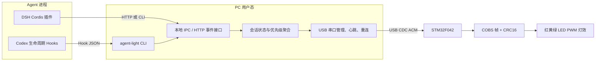
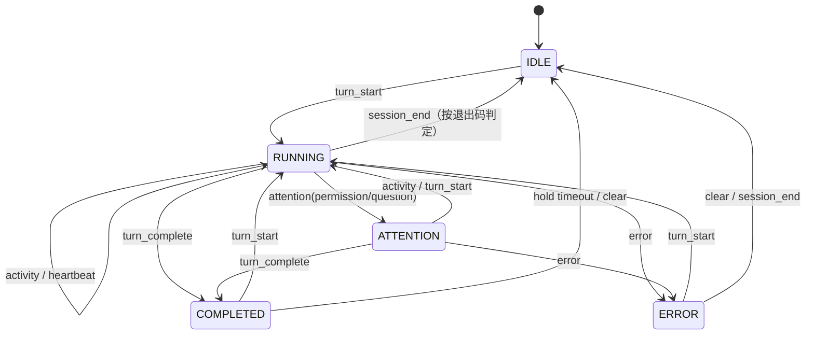

# Agent 三色状态指示灯总体设计方案

> 版本：v1.0  
> 日期：2026-10-26  
> 目标平台：Windows 优先，兼容 macOS / Linux  
> 目标 Agent：DeepSeek Harness（DSH）、OpenAI Codex  
> 文档性质：可实施的工程设计基线，接口示例需在锁定的 DSH / Codex 版本上复核

## 1. 产品目标与设计结论

设计一款参考机床红黄绿三色塔的 USB Agent 状态灯，挂在显示器上，用灯光提示本机 AI 编程助手的工作状态。

| 显示状态 | 灯效 | 含义 |
|---|---|---|
| 空闲 `IDLE` | 全灭 | 没有活动任务，或尚未接入 Agent |
| 运行 `RUNNING` | 黄色常亮 | 正在推理、调用工具或执行命令 |
| 等待处理 `ATTENTION` | 红色常亮 | 正在等待用户选择、批准、补全输入 |
| 错误 `ERROR` | 红色 2 Hz 闪烁 | 明确收到 Agent 错误、异常退出等事件 |
| 完成 `COMPLETED` | 绿色常亮 | 当前回合结束；不自动等同于业务结果正确 |
| 链路异常 `LINK_LOST` | 黄色慢闪 | PC 服务与设备失联，不能据此判断 AI 状态 |

核心结论：

1. **首选 STM32F042F6P6 + USB CDC ACM + 三颗独立高亮 LED**。无需私有内核驱动，Windows、macOS、Linux 均可使用系统 CDC 驱动。
2. **USB 不直接读取 AI 状态**。DSH / Codex 插件负责采集生命周期事件，PC 本地服务负责状态聚合，再通过 USB 只下发最终灯态。
3. **PC 端首选 Python 用户态服务**，同时提供 `agent-light` CLI，方便 Codex Hook 直接调用；DSH 使用 TypeScript 原生 Cordis 插件。
4. **多会话采用优先级聚合**：错误 > 等待处理 > 运行 > 完成 > 空闲，避免一个空闲会话覆盖另一个仍在运行的会话。
5. **红色“等待”和“错误”用常亮/闪烁区分**；无事件超时不默认判错，防止长推理被误报为卡死。

## 2. 需求边界与非目标

### 2.1 功能需求

- USB 同时供电与通信，设备插拔后可自动重连。
- 支持 DSH 与 Codex，允许多个终端、多个会话同时存在。
- 状态上报失败不得阻塞、修改或否决 Agent 的原有操作。
- 本地运行，不依赖云服务，不上传提示词、代码、工具参数或模型回答。
- 支持亮度配置、完成保持时间、手动测试灯和手动清除状态。
- 装置小型化，适合显示器顶边或侧边安装。

### 2.2 非目标

- 不做声光报警器、蜂鸣器和无线联网。
- 不通过屏幕 OCR、终端文本匹配作为首选状态来源。
- 不让灯具直接访问模型 API，也不在固件中保存 AI 会话信息。
- 不承诺识别所有“语义卡住”：静默、模型思考过久与死循环只能做可选超时提示，不能可靠自动区分。
- 绿色只表示观测到回合结束，不表示测试通过、代码正确或任务验收成功。

## 3. 总体架构



各层职责必须保持单一：

- **插件层**：只把厂商事件转换为统一事件，不直接操作 COM 口。
- **服务层**：维护会话、处理并发和超时、决定唯一物理灯的最终状态。
- **设备层**：只执行灯态、心跳和链路看门狗，不理解 DSH / Codex。
- **USB 驱动层**：使用操作系统 CDC ACM 驱动，不开发私有内核驱动。

## 4. 硬件设计

### 4.1 推荐规格

| 项目 | 建议值 |
|---|---|
| PCB 尺寸 | 约 40 mm × 12 mm，四层非必需，双层板即可 |
| 成品尺寸 | 约 45 mm × 16 mm × 8 mm，不含线材 |
| MCU | STM32F042F6P6，TSSOP-20，32 KB Flash，6 KB SRAM |
| USB | USB 2.0 Full Speed Device，CDC ACM |
| 时钟 | 使用 HSI48 + CRS 的免晶振 USB 方案；按具体料号数据手册校验 |
| 接口 | USB-C 16Pin 母座，仅使用 USB 2.0 与供电 |
| 光源 | 红、黄、绿各一颗高效率 0805 LED，或侧发光 LED + 导光柱 |
| 供电 | USB 5 V 输入，板载 3.3 V LDO |
| 工作电流 | 目标小于 30 mA，任何时刻默认只亮一颗状态 LED |
| 调试 | SWDIO、SWCLK、NRST、GND、3V3 测试焊盘 |
| 安装 | 显示器背胶卡扣、磁吸片或顶部弹性夹，外壳约 10 g 目标 |

不推荐首版使用 WS2812 / SK6812：三颗独立 LED 更符合三色塔语义，电路和固件更简单，静态功耗和光色串扰也更易控制。

### 4.2 电源与 USB 电路

```text
USB-C VBUS 5V
  ├─ 自恢复保险丝（可选）─ 磁珠（可选）─ 3.3V LDO ─ MCU + LED
  ├─ VBUS 检测/TVS（按布局与成本取舍）
  └─ CC1、CC2 各接 5.1 kΩ 到 GND，声明为 UFP/受电设备

USB-C D+ / D-
  └─ 低电容 ESD 阵列 ─ 约 22 Ω 串阻 ─ PA12 / PA11
```

设计要点：

- 每路 VDD 就近放置 100 nF 去耦，芯片附近放置 4.7 µF  bulk 电容。
- LDO 输入、输出电容严格按所选型号数据手册选型，不直接套用容量。
- USB D+/D- 按 90 Ω 差分目标布线，短、平行、少过孔，下方保持完整地平面。
- ESD 器件选择低电容 USB 专用型号，并靠近 USB-C 连接器放置。
- USB 上拉是否外置以 STM32F042 具体型号手册为准；若芯片未集成可控上拉，再增加 1.5 kΩ 上拉电路。
- 外壳屏蔽层接地方式预留 `1 MΩ || 1 nF` 与直连两种调试选项，量产前做 ESD/EMI 验证。
- 不使用 ST 的默认 VID/PID 作为量产标识；原型可内部实验，发布时申请合法 VID/PID 或使用允许的开源 PID。

### 4.3 MCU 最小系统与外设分配

| 信号 | 建议引脚 | 说明 |
|---|---|---|
| USB_DM / USB_DP | PA11 / PA12 | USB Full Speed |
| LED_R / LED_Y / LED_G | PA0 / PA1 / PA2 | 支持定时器 PWM 的通道，最终按原理图复核 |
| SWDIO / SWCLK | PA13 / PA14 | 烧录和调试 |
| NRST | NRST | 复位，预留测试点 |
| BOOT0 | BOOT0 | 默认下拉，预留进入系统 Bootloader 的焊盘或按键 |

- 三颗 LED 各串限流电阻，首版可从 680 Ω 开始，根据实际 LED 压降和夜间亮度调整。
- GPIO 直驱目标为每颗约 1–3 mA；若选用高压降或低效率 LED，再复核电流与 GPIO 总电流。
- PWM 调光频率建议大于 1 kHz，避免肉眼闪烁和摄像条纹；状态闪烁由低频软件模式控制。
- NRST、BOOT0 的阻容按 ST 硬件设计指南处理，不为节省焊盘而省略必要下拉。
- 首版固件通过 SWD 烧录；USB DFU 作为后续选项，能力以 AN2606 对具体料号的说明为准。

### 4.4 光学与结构

三色位置从上到下固定为红、黄、绿，避免不同固件版本交换顺序。

- 使用三个独立遮光仓和乳白扩散片，避免红灯点亮时黄/绿区域漏光。
- 若挂在显示器顶部，灯光朝前并略向下，减少直射眼睛；支持 20%–100% 软件亮度。
- USB-C 放在背部或底部，避免线材把灯从显示器上拉起；卡扣需要考虑线缆弯折半径。
- 首版可用 3D 打印遮光内骨架 + 半透明前面板；量产再改注塑导光柱。
- 设备无需主动散热，但 USB、LDO 和 LED 区域仍应留敷铜散热空间。

### 4.5 首版 BOM

| 数量 | 器件 | 备注 |
|---:|---|---|
| 1 | STM32F042F6P6 | 主控与 USB |
| 1 | 3.3 V LDO，100 mA 以上 | 低静态电流非关键，稳定性优先 |
| 1 | USB-C 16Pin 母座 | 含 D+/D-，不能只选供电型连接器 |
| 2 | 5.1 kΩ 电阻 | CC1/CC2 下拉 |
| 2 | 约 22 Ω 电阻 | USB 串阻 |
| 1 | USB 低电容 ESD 阵列 | 靠近接口 |
| 3 | 红/黄/绿高效率 LED | 统一封装和发光角度 |
| 3 | LED 限流电阻 | 首版建议 680 Ω 起调 |
| 若干 | 100 nF、4.7 µF 等 | 去耦与 LDO 外围 |
| 1 | 复位/BOOT 外围与 SWD 焊盘 | 便于生产和维修 |

## 5. 嵌入式固件设计

### 5.1 软件结构

首版无需 RTOS，采用 STM32Cube HAL/LL + 中断 + 主循环协作式架构。

```text
main
 ├─ USB CDC 驱动：收发描述符、端点回调、挂起/恢复
 ├─ RX 环形缓冲区：至少 128 字节，中断只入队
 ├─ 协议解析器：COBS 解码、长度检查、CRC、序号去重
 ├─ 命令处理：SET_STATE / HEARTBEAT / GET_STATUS / SET_CONFIG
 ├─ 灯效引擎：状态机 + PWM 亮度 + 闪烁相位
 ├─ 链路看门狗：检查最后一帧有效通信时间
 └─ 非易失配置：亮度、灯效参数、CRC 与版本号
```

约束：

- USB 中断中不做协议解析、Flash 写入或复杂灯效计算。
- 主循环解析完整帧，所有长度字段先校验再访问缓冲区。
- CRC 错误、未知命令、长度错误返回 NACK；连续坏帧不能改变当前灯态。
- 相同 `seq` 的重发 `SET_STATE` 必须幂等，直接重发 ACK，不重复触发灯效。
- Flash 配置使用双槽或“序号 + CRC”，防止写入中途掉电导致配置损坏。
- 开启独立看门狗可选；首版至少保证协议异常不会卡死主循环。

### 5.2 固件状态与超时

| 状态 | 进入条件 | 退出条件 | 灯效 |
|---|---|---|---|
| `BOOT` | 上电/复位 | 自检完成 | 红→黄→绿各短亮一次 |
| `IDLE` | 收到空闲命令 | 收到其他状态 | 全灭 |
| `RUNNING` | 收到运行命令 | 新状态或链路超时 | 黄色常亮 |
| `ATTENTION` | 收到等待命令 | 新状态或链路超时 | 红色常亮 |
| `ERROR` | 收到错误命令 | 新状态或链路超时 | 红色 2 Hz 闪烁 |
| `COMPLETED` | 收到完成命令 | 新任务、清除或保持超时 | 绿色常亮 |
| `LINK_LOST` | 5 秒无有效心跳/命令 | 通信恢复 | 黄色慢闪 |

链路超时只表示 USB/PC 服务异常，**不得自动改写成 AI 错误**。PC 服务恢复后发送当前聚合状态，设备立即恢复。

`COMPLETED` 默认保持到下一次 `RUNNING` 或手动清除；可配置 300 秒后转为 `IDLE`。运行和等待状态不在固件内做业务超时，超时策略由 PC 服务统一处理。

### 5.3 固件模块划分

```text
firmware/
 ├─ Core/                 # 初始化、主循环、中断
 ├─ USB_Device/           # CDC ACM
 ├─ app/
 │   ├─ protocol.c/.h     # 帧解析、CRC、命令分发
 │   ├─ light_fsm.c/.h    # 灯态与看门狗
 │   ├─ led_pwm.c/.h      # PWM 与灯效
 │   └─ settings.c/.h     # 配置持久化
 └─ tests/                # 可在主机运行的协议单元测试
```

## 6. USB 通信协议

### 6.1 传输选择

使用 USB CDC ACM。虚拟串口参数可显示为 115200 8-N-1，但 USB CDC 的实际速率不依赖传统 UART 波特率。CDC 是字节流，仍需明确帧边界，因此采用 **COBS 编码 + `0x00` 分隔 + CRC16-CCITT**。

不直接发送 JSON Lines 的原因：二进制协议更容易做长度校验、固件解析和故障注入测试；JSON 只保留在 PC 本地事件接口。

### 6.2 帧格式

COBS 编码前的原始帧：

| 字段 | 长度 | 说明 |
|---|---:|---|
| `version` | 1 | 协议版本，首版为 `0x01` |
| `type` | 1 | 命令/响应类型 |
| `seq` | 1 | 请求序号，响应原样返回 |
| `length` | 1 | Payload 长度，首版最大 32 字节 |
| `payload` | 0–32 | 小端字段 |
| `crc16` | 2 | 对 `version` 到 `payload` 计算，CRC16-CCITT-FALSE |

整个原始帧经 COBS 编码后发送，末尾追加 `0x00`。接收端设置最大帧长，超过即丢弃并重新同步，防止内存越界。

### 6.3 命令定义

| 类型 | 名称 | Payload | 响应 |
|---|---|---|---|
| `0x01` | `SET_STATE` | `state:u8, pattern:u8, brightness:u8, hold_s:u16` | ACK |
| `0x02` | `HEARTBEAT` | `host_uptime_s:u32` | ACK + `device_uptime_s:u32` |
| `0x03` | `GET_STATUS` | 空 | STATUS |
| `0x04` | `SET_CONFIG` | `default_brightness:u8, watchdog_s:u8` | ACK |
| `0x05` | `CLEAR` | 空 | ACK |
| `0x81` | `ACK` | `command:u8, result:u8, data:0..N` | — |
| `0x82` | `NACK` | `command:u8, error:u8` | — |
| `0x83` | `STATUS` | `state:u8, last_seq:u8, fw:u16, uptime_s:u32` | — |

状态枚举：`0=IDLE`、`1=RUNNING`、`2=ATTENTION`、`3=ERROR`、`4=COMPLETED`、`5=LINK_LOST`。`LINK_LOST` 通常由设备本地进入，PC 不应主动用它表达 Agent 状态。

可靠性规则：

- PC 对 `SET_STATE` 等待 100 ms ACK，超时最多重试 2 次，使用相同 `seq`。
- PC 每 1 秒发送一次心跳；设备连续 5 秒无有效帧进入 `LINK_LOST`。
- ACK 丢失会造成重发，设备必须按 `seq + type + payload` 去重。
- 固件升级不改变状态枚举的既有数值；新增能力通过版本和命令扩展。
- 协议不传输提示词、代码、错误正文或模型回答。

## 7. PC 端软件设计

### 7.1 推荐技术栈

- Python 3.11+。
- `pyserial`：CDC 串口访问。
- `asyncio`：心跳、重连、状态计时器。
- 本地 HTTP 可使用 `aiohttp`；CLI 与 Hook 共用同一事件模型。
- 打包：PyInstaller 或可复制运行的 Python 环境；Windows 首版提供托盘程序与开机启动选项。

组件：

```text
pc/
 ├─ agent_lightd/          # 常驻服务
 │   ├─ api.py             # 本地事件接口
 │   ├─ aggregator.py      # 多会话状态聚合
 │   ├─ serial_link.py     # 发现、协议、ACK、心跳、重连
 │   └─ config.py
 ├─ agent_light_cli/       # agent-light 命令
 ├─ tests/
 └─ packaging/
```

### 7.2 本地事件接口

默认监听 `127.0.0.1:47632`，不得绑定 `0.0.0.0`。每次安装生成随机 token，配置文件仅当前用户可读；请求使用 `Authorization: Bearer <token>`。CLI 从用户配置读取 token。

统一事件：

```json
{
  "version": 1,
  "event_id": "01J...",
  "source": "codex",
  "session_id": "thr_123",
  "turn_id": "turn_456",
  "type": "turn_start",
  "occurred_at": "2026-10-26T00:00:00+08:00"
}
```

字段规则：

- `source`：`dsh | codex | wrapper | manual`。
- `type`：`session_start | turn_start | activity | attention | error | turn_complete | session_end | clear`。
- `session_id` 必填；`turn_id` 可空，但存在时用于乱序防护和去重。
- `event_id` 用于去重；Hook 重试不能反复切换灯态。
- 可选 `reason_code` 仅允许枚举，例如 `permission | question | model_error | process_exit | stale`，不传原始文本。
- 不接收 `prompt`、`tool_input`、`last_assistant_message` 字段；即使上游包含，也应在适配器入口立即丢弃。

建议接口：

| 接口 | 用途 |
|---|---|
| `POST /v1/events` | 上报统一事件，快速返回 |
| `GET /v1/status` | 查看各会话、聚合灯态、设备连接状态 |
| `POST /v1/display/test` | 依次测试红黄绿，不修改 Agent 会话 |
| `POST /v1/display/clear` | 清除完成/错误或指定会话 |
| `GET /v1/health` | CLI 健康检查，不泄露会话内容 |

### 7.3 会话状态机

每个 `(source, session_id)` 独立保存状态：



事件处理原则：

- 新 `turn_start` 总是清除该会话旧的 `ERROR` 和 `COMPLETED`。
- 迟到事件不能覆盖更新的 `turn_id`；同一回合使用本地单调序号处理乱序。
- `session_end` 正常退出转为 `IDLE`；进程包装器明确给出非零退出时先转为 `ERROR`。
- 可选 `stale_after` 默认为关闭；开启后建议至少 10 分钟无事件才转为 `ATTENTION/stale`。
- 服务重启时不恢复旧的运行态，默认从空闲开始，等待 Agent 新事件。

### 7.4 多会话聚合

每个周期计算：

```text
if 任一会话 ERROR:                 显示 ERROR
else if 任一会话 ATTENTION:        显示 ATTENTION
else if 任一会话 RUNNING:          显示 RUNNING
else if 存在未清除 COMPLETED:      显示 COMPLETED
else:                              显示 IDLE
```

只有聚合结果变化时才发送 `SET_STATE`，心跳独立发送，避免串口流量随 token/工具事件增长。

可选增强：托盘菜单显示具体占用会话，支持“只监控指定工作区”和“错误优先/最近活动优先”策略；首版固定使用上述优先级。

### 7.5 串口发现与故障处理

- 按配置的 VID/PID 和设备序列号发现设备，不盲目打开第一个 COM 口。
- 串口被占用、设备拔出或写失败时进入重连，退避间隔从 0.5 秒到 5 秒。
- 服务启动、设备重连、配置变更后立即同步一次当前聚合状态。
- Agent 上报使用短超时和有限队列；服务不可用时 CLI 静默退出 0，DSH 插件丢弃最旧事件并计数，不影响 Agent。
- 日志默认只记录事件类型、时间、脱敏会话 ID 和结果，不记录用户内容。

## 8. DSH 插件设计

### 8.1 接入方式

DSH 基于 Cordis 插件体系，使用 TypeScript 原生插件，导出 `apply(ctx, config)`。与外部 Hook 脚本相比，原生插件可直接观察会话事件和 Agent 生命周期，延迟更低。

推荐包名：`agent-light-dsh`。建议锁定一个经过测试的 DSH 版本，并把“版本适配层”独立成文件，避免预览版事件变化影响主逻辑。

```text
plugins/dsh/
 ├─ package.json
 ├─ src/
 │   ├─ index.ts           # apply(ctx, config)，注册生命周期
 │   ├─ adapter.ts         # DSH 版本相关事件映射
 │   ├─ reporter.ts        # 非阻塞 HTTP 上报、队列、超时
 │   └─ types.ts
 └─ README.md
```

### 8.2 事件映射

| DSH 扩展点/事件 | 统一事件 | 说明 |
|---|---|---|
| `agent/pre-step` | `turn_start` 或 `activity` | 回合首次进入时上报开始，后续 step 只更新活动时间 |
| `agent/assistant-stream` | `activity` | 只用于保活，应按 1 秒节流，不上传 token 内容 |
| `tools/pre-execute` | `activity` | 工具执行前表明仍在运行；必须调用并返回 `next()`，不得改变决策 |
| `tools/result` | `activity` | 只观察最终工具结果，不读取/上报内容 |
| `turn/end`（`session/event`） | `turn_complete` | 回合结束，转绿色 |
| `agent/request-error` | `error` | 明确的模型请求错误，转红色闪烁 |
| Agent dispose / 正常退出 | `session_end` | 清理会话 |
| 审批/AskUserQuestion 适配点 | `attention` / 后续 `activity` | 通过版本适配器实现，见下方限制 |

官方扩展文档确认了 `agent/pre-step`、`tools/pre-execute`、`tools/result`、`agent/request-error`、`session/event` 与 `turn/end` 等接缝。审批 API 和 AskUserQuestion 的具体可观察事件更依赖版本：实现时应针对锁定版本检查 `ctx.approval` 及相关会话事件，不在未核实前虚构统一事件名。

### 8.3 插件伪代码

```ts
export function apply(ctx: Context, config: Config) {
  const reporter = createNonBlockingReporter(config)

  ctx.on('agent/pre-step', async (agent, next) => {
    reporter.activity(sessionOf(agent), 'step')
    return next()
  })

  ctx.on('session/event', (session, event) => {
    if (event.type === 'turn/end') {
      reporter.complete(sessionIdOf(session), turnIdOf(event))
    }
  })

  ctx.on('agent/request-error', (agent, error, next) => {
    reporter.error(sessionOf(agent), 'model_error')
    return next(error)
  })

  // 审批与提问事件由 adapter.ts 按锁定的 DSH 版本注册。
  registerApprovalAdapter(ctx, reporter)
}
```

以上只表达结构，不作为可直接编译的固定签名。真正实现必须以目标 DSH 版本的类型定义为准，尤其不要猜测 `next()` 的参数和错误传播方式。

### 8.4 非阻塞与安全要求

- 所有网络调用使用 `fire-and-forget`，设置 100–200 ms 超时，不在模型或工具关键路径等待 USB。
- 队列上限建议 64；只保留每个会话最新保活事件，完成、等待和错误事件优先。
- 不上报 `event.data`、工具结果、错误正文，仅映射内部枚举。
- 插件异常只写本地诊断日志，不能改变工具调用的 allow/ask/deny 结果。
- 分别安装并测试 `web`、`headless` 等实际使用的 profile，例如：

```bash
dsh plugin --profile web add /absolute/path/to/agent-light-dsh
dsh plugin --profile headless add /absolute/path/to/agent-light-dsh
```

命令仅为安装形式示例，最终按目标 DSH 版本的 CLI 文档执行。

## 9. Codex 插件与 Hooks 设计

### 9.1 推荐目录

```text
plugins/codex/agent-light/
 ├─ .codex-plugin/
 │   └─ plugin.json
 └─ hooks/
     ├─ hooks.json
     └─ README.md
```

`plugin.json`：

```json
{
  "name": "agent-light",
  "version": "0.1.0",
  "description": "Report local Codex lifecycle state to the Agent USB indicator.",
  "hooks": "./hooks/hooks.json"
}
```

Hook 统一调用已安装的 CLI；Codex 通过 **stdin** 传入 Hook JSON，而不是旧版 `notify` 的 argv 形式：

```json
{
  "hooks": {
    "SessionStart": [{
      "hooks": [{ "type": "command", "command": "agent-light hook codex", "timeout": 2 }]
    }],
    "UserPromptSubmit": [{
      "hooks": [{ "type": "command", "command": "agent-light hook codex", "timeout": 2 }]
    }],
    "PreToolUse": [{
      "hooks": [{ "type": "command", "command": "agent-light hook codex", "timeout": 2 }]
    }],
    "PermissionRequest": [{
      "hooks": [{ "type": "command", "command": "agent-light hook codex", "timeout": 2 }]
    }],
    "PostToolUse": [{
      "hooks": [{ "type": "command", "command": "agent-light hook codex", "timeout": 2 }]
    }],
    "Stop": [{
      "hooks": [{ "type": "command", "command": "agent-light hook codex", "timeout": 2 }]
    }],
    "SessionEnd": [{
      "hooks": [{ "type": "command", "command": "agent-light hook codex", "timeout": 1 }]
    }]
  }
}
```

Windows 若不能直接解析 `agent-light`，为每项增加 `commandWindows`，指向安装后的完整 `agent-light.exe` 路径。不要把用户目录写死在可分发的插件中；可由安装器生成用户级 Hook，或使用已加入 PATH 的 launcher。

### 9.2 事件映射

| Codex Hook | 统一事件 | 灯态变化 |
|---|---|---|
| `SessionStart` | `session_start` | 空闲；不能因 resume 误判为运行 |
| `UserPromptSubmit` | `turn_start` | 黄色常亮 |
| `PreToolUse` | `activity` | 黄色常亮；也从等待审批恢复 |
| `PermissionRequest` | `attention(permission)` | 红色常亮 |
| `PostToolUse` | `activity` | 黄色常亮；即使工具非零退出也不能单独判为 AI 错误 |
| `Stop` | `turn_complete` | 绿色常亮 |
| `SessionEnd` | `session_end` | 清除该会话 |
| `SubagentStart/Stop` | 可选 `activity` | 首版不改变主会话最终状态 |

`Stop` 表示“回合准备停止”，也可能由中断触发，因此绿色语义必须写成“回合结束”，不能写成“任务成功”。

### 9.3 Codex Hook CLI 行为

`agent-light hook codex` 应：

1. 从 stdin 读取一个 JSON，设置输入大小上限，例如 1 MiB。
2. 只提取 `session_id`、`turn_id`、`hook_event_name`、`cwd` 的哈希（可选），其余字段立即丢弃。
3. 映射并发送到本地服务；服务不可用时仍尽快退出 0。
4. 普通事件不输出 stdout，避免把文本注入 Agent 上下文。
5. `Stop` 按 Codex 协议需要时输出最小 JSON `{}`，不返回 `decision:block`，防止意外让 Agent 继续。
6. 永远不返回批准、拒绝、输入改写或上下文，保持“纯观察”角色。

Codex 要求非托管 Hook 经用户审核并信任；插件安装后仍需在 `/hooks` 中确认。修改 Hook 后哈希变化，需要重新审核。项目本地 Hook 只在项目受信任时加载，因此个人状态灯优先使用用户级配置或用户明确信任的插件 Hook。

### 9.4 Codex 错误检测的边界

当前 Hooks 没有通用 `Error` 事件，无法只靠 Hook 可靠捕获所有模型 API 错误、崩溃和卡死。首版提供两级能力：

- **基础版**：`PermissionRequest` 红灯常亮，`Stop` 绿灯，其他生命周期黄灯；明确的 Codex 内部错误可能无法自动变红。
- **增强版**：为 `codex exec` 提供进程包装器，捕获非零退出码并上报 `error(process_exit)`；交互式 TUI 或需要更丰富状态时，可另做受版本约束的 app-server 事件适配器。

禁止把终端出现 “error” 字样直接等同于任务失败，也不要把 `PostToolUse` 中非零 shell 结果直接升级为全局 AI 错误，因为编译失败和测试失败常是 Agent 正常工作过程的一部分。

## 10. 状态语义与异常策略

### 10.1 推荐判定表

| 场景 | 显示 | 是否自动恢复 |
|---|---|---|
| 用户刚提交任务 | 黄常亮 | 是 |
| 模型推理或工具执行 | 黄常亮 | 是 |
| 等待权限批准 | 红常亮 | 下一活动/完成事件恢复 |
| 等待模型主动提问 | 红常亮 | 用户回答后新事件恢复 |
| 明确模型请求失败 | 红闪 | 新任务或手动清除 |
| 子进程非零退出且 Agent 仍继续 | 保持黄 | 不视为全局错误 |
| 回合结束 | 绿常亮 | 新任务或保持超时 |
| Codex 用户中断导致 Stop | 绿常亮，可配置为空闲 | 新任务 |
| USB 仍供电但 PC 服务停止/心跳丢失 | 黄慢闪 | 链路恢复 |
| USB 线缆拔出 | 设备断电、全灭 | 重新上电后自检并同步 |
| 长时间无任何事件 | 默认保持原状态 | 可选超时后红常亮 |

### 10.2 为什么“卡住”不能只靠超时

模型长推理、大命令执行、用户离开、进程死锁都可能表现为静默。默认基于明确事件显示，避免误报；可选 `stale_after` 只表达“长时间未收到活动，请检查”，仍使用红常亮而非红闪，不宣称检测到错误。

## 11. 配置、隐私与安全

建议用户配置：

```yaml
serial:
  vid: 0x0000
  pid: 0x0000
server:
  host: 127.0.0.1
  port: 47632
display:
  brightness: 0.35
  completed_hold_seconds: 300
  stale_after_seconds: 0
privacy:
  hash_cwd: true
```

安全措施：

- 本地接口仅监听回环地址，并使用随机 token；不对局域网开放。
- 不传输模型内容、工具输入输出、文件路径明文和错误正文。
- Hook 只观察，不赋予灯具批准权限，不让 USB 设备反向触发 Agent 操作。
- 固件默认只接收有限长度命令，不需要安全启动，但发布固件应记录版本和校验值。
- 安装器只修改用户明确选择的 DSH profile / Codex 配置，卸载时恢复原配置并保留备份。
- 代码签名、自动更新和量产 VID/PID 属发布阶段事项，不与首版验证耦合。

## 12. 测试与验收

### 12.1 固件与协议

- COBS 编解码、CRC、所有长度边界、随机字节和截断帧模糊测试。
- ACK 丢失、重复序号、乱序命令、设备拔插、USB 挂起恢复测试。
- 5 秒链路看门狗测试，恢复后必须同步 PC 当前状态。
- 连续运行 24 小时，无内存泄漏、协议卡死或灯效漂移。
- 测量 USB 枚举、LED 电流、3.3 V 纹波和整机功耗。

### 12.2 PC 服务

- 每个统一事件的单元测试，以及重复、迟到、跨回合事件测试。
- 多会话优先级组合测试：空闲不能覆盖运行，完成不能覆盖等待。
- 服务未启动时，DSH/Codex 的操作延迟和结果不受影响。
- 串口占用、设备热插拔、服务重启后均能自动恢复。
- 日志抓包确认不包含 prompt、代码、工具参数和模型回答。

### 12.3 DSH 合约测试

- 固定 DSH 版本，录制并回放会话事件，验证开始、活动、等待、错误、结束映射。
- 验证普通工具调用和 AskUserQuestion 的等待/恢复路径。
- 验证插件不会改变工具决策，也不会阻塞 `next()`。
- 分别验证 web 与 headless profile；DSH 升级后先跑合约测试再更新适配器。

### 12.4 Codex 合约测试

- 用各 Hook 的真实 JSON 样例测试 stdin 解析和字段裁剪。
- 验证 `PermissionRequest -> PreToolUse/PostToolUse -> Stop` 的状态恢复。
- 验证 `Stop` 不输出继续指令，Hook 不意外改变 Agent 行为。
- 验证 Windows `commandWindows`、路径含空格、Python/CLI 不在交互式 PATH 的场景。
- 验证插件 Hook 的信任审核流程，以及 Codex 升级后的事件兼容性。

### 12.5 验收指标

| 指标 | 目标 |
|---|---|
| 明确事件到灯光变化 | 本地通常小于 300 ms，不含 Agent 自身调度 |
| 状态上报对 Agent 的附加阻塞 | 目标接近 0；服务故障不导致任务失败 |
| USB 重连 | 设备出现后 5 秒内恢复并同步 |
| 多会话 | 至少 8 个会话无串态 |
| 隐私 | USB 与本地事件均不含用户内容 |
| 外观 | 可挂在常见显示器顶边，白天可辨、夜间不过亮 |

## 13. 实施顺序

### 阶段 A：桌面验证

1. 用 STM32F042 开发板 + 三颗 LED 验证 USB CDC、协议和灯效。
2. 用 Python 实现串口服务、CLI 与统一状态聚合。
3. 用 `agent-light manual running|attention|error|completed|idle` 验证全链路。

### 阶段 B：Agent 接入

1. 先接 Codex 的用户级 Hooks，跑通黄、红等待、绿完成。
2. 再实现 DSH 原生插件，锁定版本并补齐审批适配器。
3. 增加 Codex 进程包装器，补充可明确判定的异常退出。

### 阶段 C：硬件小型化

1. 绘制原理图和 PCB，预留 SWD/BOOT 测试点。
2. 打样后验证 USB 稳定性、LED 亮度、串光和外壳安装。
3. 完成 Windows 托盘与开机启动，再补 macOS/Linux 打包。

### 阶段 D：发布准备

- 固化协议版本、插件支持矩阵、升级/回滚策略。
- 处理合法 VID/PID、安装包签名、固件校验与使用说明。
- 再考虑 USB DFU、多设备、多工作区筛选等增强功能。

## 14. 首版建议裁剪范围

为了尽快得到可靠成品，首版只保留：

- 一个 USB CDC 设备、三颗 LED、无蜂鸣器、无无线功能。
- 一个 Python 常驻服务和一个 CLI。
- DSH 原生插件 + Codex Hooks 两种适配器。
- 五种 Agent 灯态与一种链路异常灯态。
- 本地配置和手动测试，不做 Web 控制台。
- 错误只响应明确事件；静默超时检测默认关闭。

这套裁剪能覆盖主要使用场景，同时把最大的不确定性——不同 Agent 版本的事件语义——隔离在 PC 适配器内，硬件和固件无需随 Agent 升级而修改。

## 15. 参考资料与版本注意事项

以下资料用于确认扩展机制；DSH 仍可能处于预览阶段，Codex Hooks 也在演进，实施时应把实际版本号和事件样例纳入测试基线。

1. DeepSeek Harness，Extension Cookbook：  
   https://github.com/deepseek-ai/deepseek-harness/blob/master/docs/cookbook/extension-cookbook.md
2. DeepSeek Harness，Conversation subsystem：  
   https://github.com/deepseek-ai/deepseek-harness/blob/master/docs/subsystems/conversation.md
3. OpenAI Codex，Hooks：  
   https://developers.openai.com/codex/hooks
4. OpenAI Codex，Build plugins：  
   https://developers.openai.com/codex/plugins/build
5. OpenAI Codex，Advanced configuration：  
   https://developers.openai.com/codex/config-advanced

访问日期：2026-10-26。若官方页面与目标安装版本行为不一致，以目标版本的类型定义、CLI 输出和真实 Hook JSON 为准，并只修改对应适配器。
