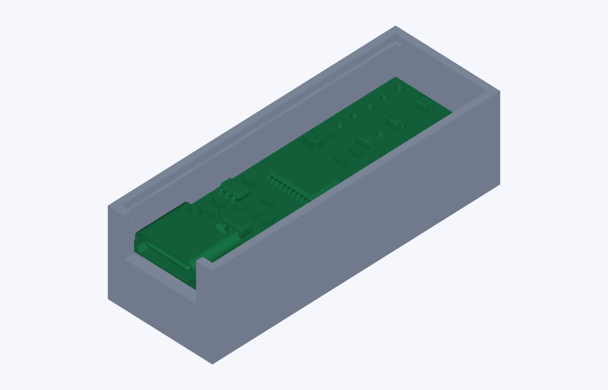

# Agent Light 外壳

原始 SolidWorks 2024 底壳、顶盖、装配体及 PCB STEP 保留在本目录。

本次修改见 [Rev B 交付说明](revision-2026-11-12/README-交付说明.md)：打印底壳、顶部敞开的 Type-C 装入槽、焊点避让和胶粘透明亚克力盖。默认模型已翻正为 +Y 开口朝上。

- 编辑：[底壳 SW 模型](revision-2026-11-12/底壳-RevB.SLDPRT)
- 打印：[平底朝下 STL](revision-2026-11-12/底壳-RevB-平底打印.stl)，毫米制
- 亚克力：[44×16 mm 切割 DXF](revision-2026-11-12/亚克力顶盖-44x16-切割.dxf)，另指定板厚 2 mm
- 预览：

先试装、测试 USB 插拔，再固定 PCB 并粘顶盖。数字模型检查不能代替手焊实板和打印公差验证。

大型 PCB 检查装配 STEP 不纳入 Git；在安装 CAD 验证依赖后，运行 `py shell/revision-2026-11-12/verify_fit.py` 可重新生成，并执行静态干涉及垂直装入路径检查。
